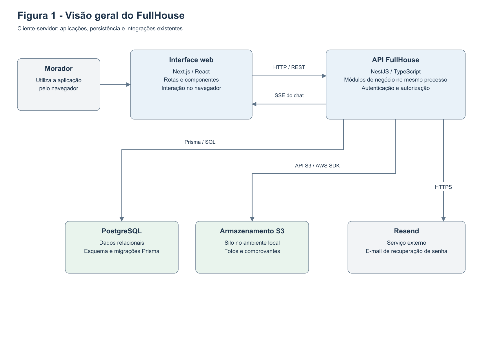
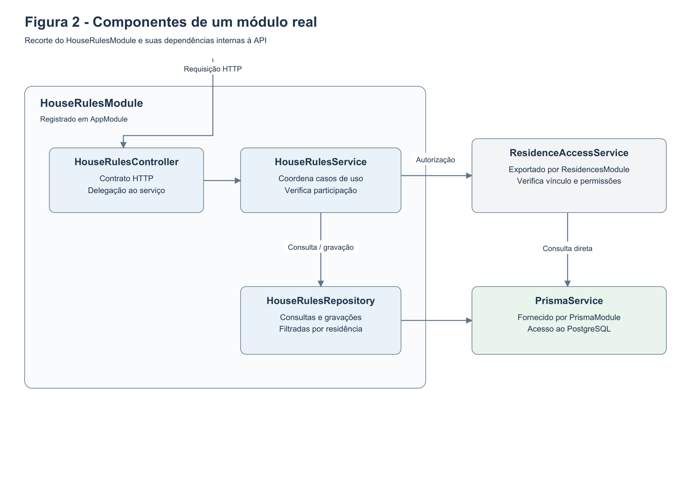
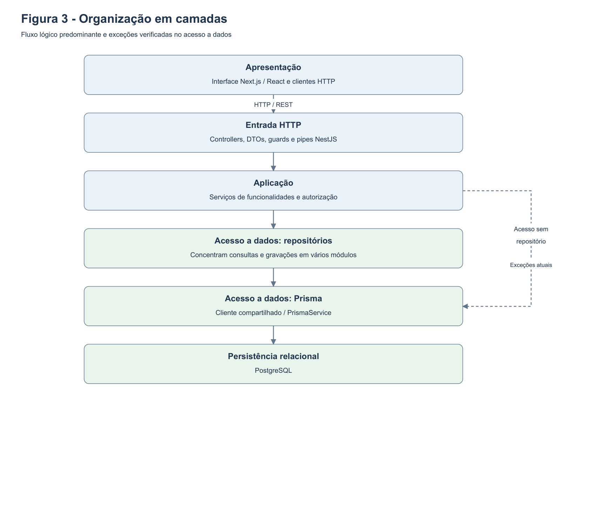

# Arquitetura do FullHouse

## Classificação e escopo

O FullHouse implementa uma **arquitetura cliente-servidor em camadas, com backend monolítico modular**. A apresentação utiliza Next.js e React, a aplicação e as regras de negócio ficam na API NestJS, e a persistência utiliza Prisma e PostgreSQL. Os módulos de negócio compõem uma única aplicação de backend, inicializada pelo `AppModule`.

“Cliente-servidor” descreve a comunicação entre interface e API. “Monolítico modular” descreve a organização interna e a implantação conjunta dos módulos da API. Essas classificações se complementam. Frontend e backend continuam sendo aplicações separadas no mesmo repositório.

O código adota camadas abertas: alguns serviços acessam diretamente o Prisma, portanto o fluxo por repositório não é obrigatório em todos os módulos.

## Arquitetura, figuras e diagramas

As três figuras abaixo têm propósitos diferentes. A visão geral usa níveis de abstração inspirados no C4, sem pretender reproduzir integralmente sua notação. A figura de componentes detalha um módulo real. A visão de camadas explica um fluxo existente e suas exceções.

## Figura 1 - Visão geral da solução

[PDF vetorial](pdf/01-visao-geral.pdf)

O cliente utiliza a interface web. O Next.js entrega a aplicação, e o código da interface executado no navegador utiliza a API para as operações de negócio. A API consulta o PostgreSQL por meio do Prisma, envia arquivos a um serviço compatível com S3 e pode utilizar o Resend para recuperação de senha. O chat da residência recebe mensagens por SSE, enquanto o envio de mensagens permanece em HTTP/REST.

O armazenamento local do Compose usa Silo, mantendo o nome de serviço `minio` e as variáveis `MINIO_*` por compatibilidade. Os bancos, o armazenamento e o e-mail são dependências da API.

## Figura 2 - Componentes de um módulo real

[PDF vetorial](pdf/02-componentes.pdf)

O recorte usa `HouseRulesModule`. O controller recebe as requisições HTTP e delega ao serviço. `HouseRulesService` verifica o vínculo por meio de `ResidenceAccessService`, aplica a coordenação do caso de uso e consulta `HouseRulesRepository`. O repositório usa `PrismaService`. O serviço de acesso à residência também usa o Prisma diretamente.

Fontes: [módulo](../../backend/src/house-rules/house-rules.module.ts), [controller](../../backend/src/house-rules/house-rules.controller.ts), [serviço](../../backend/src/house-rules/house-rules.service.ts), [repositório](../../backend/src/house-rules/house-rules.repository.ts) e [autorização de residência](../../backend/src/residences/residence-access.service.ts).

## Figura 3 - Organização em camadas

[PDF vetorial](pdf/03-camadas.pdf)

As três responsabilidades de alto nível são apresentação, aplicação e persistência. Dentro da API, há uma subdivisão entre entrada HTTP, serviços e repositórios. Uma camada lógica não exige um container ou servidor exclusivo.

| Responsabilidade | Implementação atual                                             | Limite                                                                                                                |
| ---------------- | --------------------------------------------------------------- | --------------------------------------------------------------------------------------------------------------------- |
| Apresentação     | `web/app`, `web/features`, `web/components` e clientes HTTP     | Organiza páginas e interação, consumindo os contratos da API. Validação visual não substitui a validação no servidor. |
| Entrada HTTP     | Controllers, DTOs, guards e pipes NestJS                        | Recebe entradas, autentica e valida o contrato, delegando ao serviço.                                                 |
| Aplicação        | Serviços por funcionalidade e serviços compartilhados de acesso | Coordena operações, permissões e transações conforme o módulo.                                                        |
| Acesso a dados   | Repositórios e `PrismaService`                                  | Executa consultas e gravações. Alguns serviços fazem esse acesso diretamente.                                         |
| Persistência     | PostgreSQL e armazenamento de objetos S3                        | Mantém dados relacionais e arquivos, respectivamente.                                                                 |

O caminho controller → serviço → repositório → Prisma aparece em regras, reuniões, chat e outros módulos. As exceções visíveis incluem `TaskExchangeService` e `ResidenceAccessService`, que acessam `PrismaService` diretamente. Isso caracteriza uma organização em camadas aberta.

## Stack e justificativas técnicas

As justificativas desta tabela explicam a adequação técnica do que já está no código.

| Elemento                                  | Uso no FullHouse                           | Justificativa técnica e consequência                                                                                                                                             |
| ----------------------------------------- | ------------------------------------------ | -------------------------------------------------------------------------------------------------------------------------------------------------------------------------------- |
| TypeScript                                | Interface e API                            | Explicita tipos e contratos nos dois projetos. Os contratos ainda são definidos em cada lado, sem geração compartilhada obrigatória.                                             |
| Next.js / React                           | Aplicação web                              | Organiza rotas e componentes de interface. As regras de acesso aos dados permanecem na API.                                                                                      |
| Tailwind CSS e bibliotecas de componentes | Interface                                  | Oferecem recursos para composição visual. Isso não define a arquitetura do backend.                                                                                              |
| NestJS                                    | API e módulos por funcionalidade           | Módulos, injeção de dependências, controllers e serviços oferecem uma estrutura para separar responsabilidades.                                                                  |
| Prisma / PostgreSQL                       | Consultas, transações, esquema e migrações | Representam relacionamentos e operações transacionais já usados pelo sistema. O acoplamento aos tipos Prisma permanece visível em parte dos serviços.                            |
| JWT em cookie HTTP-only                   | Autenticação                               | A API identifica o usuário autenticado. A autorização de residência exige a participação correspondente e não se resume à presença do token.                                     |
| HTTP/REST e SSE / RxJS                    | Operações da API e chat da residência      | REST atende consultas e comandos. SSE entrega eventos do servidor ao navegador. O fluxo SSE atual usa memória local e pressupõe uma instância da API para distribuir os eventos. |
| S3 via AWS SDK / Silo local               | Fotos e comprovantes                       | Os arquivos ficam em um serviço próprio, enquanto os registros guardam referências. O contrato é S3, mesmo com nomes `MINIO_*`.                                                  |
| Resend                                    | E-mail de recuperação                      | É uma integração opcional na inicialização, mas a chave é necessária para efetivamente enviar o e-mail.                                                                          |
| Docker Compose                            | Ambiente local                             | Coordena interface, API, PostgreSQL e Silo. A configuração atual executa servidores de desenvolvimento, não constitui um desenho validado de produção.                           |
| Vitest e GitHub Actions                   | Verificações                               | Há comandos e etapas de testes, lint e build. A existência do pipeline não comprova o resultado da execução mais recente.                                                        |

Fontes: [dependências da API](../../backend/package.json), [dependências da interface](../../web/package.json), [bootstrap HTTP](../../backend/src/main.ts), [chat](../../backend/src/chat/chat.service.ts), [armazenamento](../../backend/src/storage/storage.service.ts), [e-mail](../../backend/src/email/email.service.ts), [Compose](../../docker-compose.yml) e [CI](../../.github/workflows/ci.yml).

## Módulos e responsabilidades

Todos os módulos abaixo são registrados na mesma aplicação de backend.

| Agrupamento de leitura       | Módulos existentes                                     | Responsabilidade                                                                 |
| ---------------------------- | ------------------------------------------------------ | -------------------------------------------------------------------------------- |
| Identidade e acesso          | `users`, `auth`, `password-reset`, `crypto`            | Cadastro, autenticação, recuperação de senha e serviços criptográficos.          |
| Residência                   | `residences`                                           | Participações, permissões e acesso ao contexto da casa.                          |
| Organização doméstica        | `tasks`, `expenses`, `pantry`, `shopping-list`, `pets` | Tarefas e trocas, despesas, estoque, compras e animais.                          |
| Colaboração                  | `chat`, `house-rules`, `meetings`                      | Mensagens da casa, mural de regras e reuniões.                                   |
| Anúncios e acompanhamento    | `rooms`, `notifications`, `home`                       | Anúncios e negociação, notificações e consulta de informações da página inicial. |
| Infraestrutura compartilhada | `prisma`, `storage`, `email` e configurações HTTP      | Banco, objetos S3, e-mail e proteções transversais.                              |

A referência do inventário é [AppModule](../../backend/src/app.module.ts). Uma dependência entre módulos deve usar o serviço exportado pelo módulo responsável quando esse contrato existir.

## Registro de decisões

| Registro                                                 | Natureza                             | Conteúdo                                                        |
| -------------------------------------------------------- | ------------------------------------ | --------------------------------------------------------------- |
| [ADR-001](decisions/001-estilo-arquitetural.md)          | Descrição retrospectiva              | Cliente-servidor, camadas abertas e backend monolítico modular. |
| [ADR-002](decisions/002-convencoes-de-camadas.md)        | Estado atual e proposta de convenção | Responsabilidades e critérios para padronização incremental.    |
| [ADR-003](decisions/003-comunicacao-e-infraestrutura.md) | Decisões existentes e limites        | REST/SSE, persistência e integrações, com vínculo ao OpenSpec.  |

## Padronização incremental

A aplicação é apresentada como arquitetura em camadas. A proposta é:

1. Usar controller → serviço → repositório nas novas operações e evitar regras de negócio nos controllers.
2. Avaliar a extração de consultas de `TaskExchangeService` e `ResidenceAccessService` para repositórios próprios, preservando permissões, transações e contratos HTTP.
3. Usar serviços exportados para operações entre módulos, documentando exceções de acesso direto ao banco.
4. Consolidar os clientes HTTP existentes na interface, preservando cookies, tratamento de erros e comportamento dos consumidores.
5. Manter figuras e ADRs atualizados quando forem alteradas fronteiras ou dependências.

## Referências do estilo e da representação

- [Microsoft: arquitetura N-tier e distinção entre camadas lógicas e níveis físicos](https://learn.microsoft.com/en-us/azure/architecture/guide/architecture-styles/n-tier).
- [Microsoft: aplicações monolíticas e organização em camadas](https://learn.microsoft.com/en-us/dotnet/architecture/modern-web-apps-azure/common-web-application-architectures).
- [NestJS: módulos e dependências exportadas](https://docs.nestjs.com/modules).
- [C4: visões de contexto, containers, componentes e código](https://c4model.com/diagrams).
